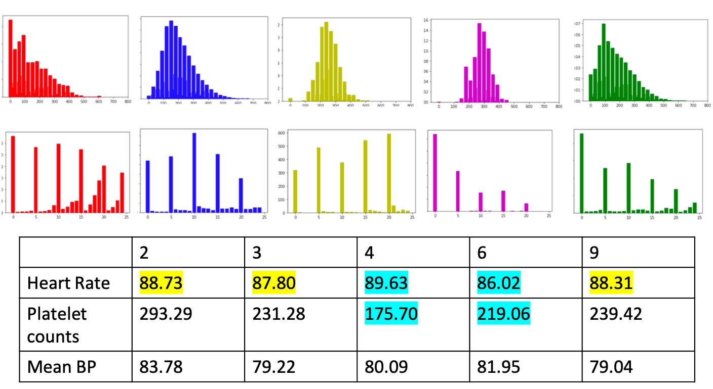

# Multi Task IRL For Sepsis

## Introduction
In this project, we attempt to model clinician's sepsis management policy as a multi - task Inverse Reinforcement Learning problem, whereby clinician's treatment may vary for patients based on heterogenity exhibited by patients. Clinical data is taken from the publicly available MIMICIII database and processed using the publicly available preprocessing code provided in the [AI clinician](https://github.com/matthieukomorowski/AI_Clinician) repository. The preprocessed data includes patient lab measurements, blood test results and other lab related variables are measured on a 4 hourly basis (state) together with the IV fluid and vasopressor amounts (action). We assume the clinician is following some optimal policy for some reward function that is unknown. 

## Modelling
**_State_** - The patient state is discretised into a tuple of `(Sofa, Arterial_lactate)` scores. The SOFA scores are discretised into `25` bins and arterial lactate scores are discretised into `30` bins. Total state space is `750`. 

**_Action_** - The action space comprises of a tuple of `(IV_fluid, vasopressor)` amounts. These amounts are discretised into `5` bins each leading to a total of `25` actions. Action `0` represents no vasopressor and iv fluid given and `24` represents the maximum amount of vasopressor and iv fluid given. `5, 10, 15, 20` represents `1,2,3,4` units of iv fluid administered to patients and no vasopressors given. 

_**Reward Features**_ - The reward function _R(s,a,s')_ is modelled as a linear combination of 2 features. The first feature is an indicator variable _phi(s,a,s')_ where _phi(s,a,s') = 1_ when there is an increase in the Sequential Organ Failure Assessment score (SOFA) from _s_ to _s_, _phi(s,a,s') = 0_ when there is no change and _phi(s,a,s') = -1_ when there is a decrease. The second feature is an indicator variable _phi(s,a,s')_ that works similarly for arterial lactate. 

## Experimental results


- 1st row shows overall state distributions for patients in each cluster. (Left -> right shows healthier patients to unhealthier patients)
- 2nd row shows the policy distributions for patients in each cluster. (Left -> right shows actions 0 to 24)
- Table shows the average heart rate, platelet count and mean BP for patients in each cluster.

### Analysis
- Red cluster shows higher amount of vasopressors given to relatively more healthy patients. If comparison is done between the red, blue and green cluster (since their distributions are more left skewed), we see that the average heart rate and BP are higher for patients in the red cluster.  
- Comparing the yellow and purple clusters, we observe that more vasopressors are given when the cluster exhibits higher heart rate and lower platelet count
- The mode of the action distribution for the green cluster is not to give any treatment, which differs from that of the blue cluster. 

## How to run
Run the repository from [AI clinician](https://github.com/matthieukomorowski/AI_Clinician) to generate `mimicdata_MK.csv` file. Then run `process_interventions.ipynb` to generate `discretised_input_data.csv`. Run `Preprocessing/Preprocessing.ipynb` to generate the matrices to be used in the Multi - Task IRL algorithm. Lastlym run the below command in `DPM_IRL` folder
```
run -r runMEIRL.m
```
